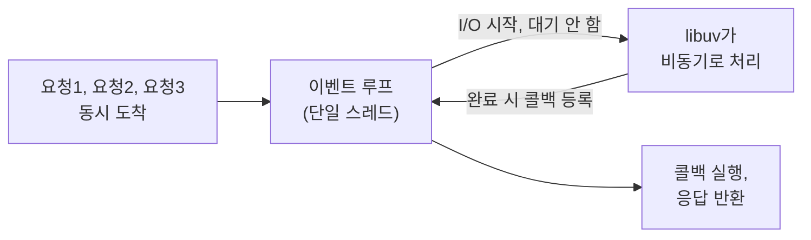

# Node.js

> 최종 업데이트: 2026-09-17 | Node.js 일반 기준

## 개념

**Node.js**는 자바스크립트를 **브라우저 밖**(서버, CLI, 툴링 등)에서 실행할 수 있게 해주는 **런타임(runtime)**이다. 크롬 브라우저가 쓰는 **V8 엔진**(자바스크립트를 기계어로 컴파일·실행하는 엔진)을 그대로 떼어내, 서버 프로그램을 짤 수 있게 만들었다.

> 자바스크립트 자체는 언어일 뿐 실행 환경이 없다. Node.js는 그 언어에 **"OS와 대화할 수 있는 손발"**(파일 시스템 접근, 네트워크 소켓 등)을 달아준 것이다.

## 배경/역사

**Ryan Dahl**이 2009년 만들어 그해 11월 JSConf Europe에서 처음 발표했다. 당시 Apache 같은 전통적 서버는 **연결마다 스레드(또는 프로세스)를 하나씩 배정**하는 방식이라, 동시접속이 수천 건을 넘어가면 스레드 컨텍스트 스위칭 비용으로 서버가 힘들어졌다. Dahl은 이 "요청마다 스레드 하나"라는 순차적 프로그래밍 패러다임 자체를 문제로 지목하고, **단일 스레드가 논블로킹 I/O로 수천 개 연결을 동시에 처리**하는 방식을 택했다.

- **2010년 1월** — 패키지 매니저 **npm** 등장, 이후 자바스크립트 생태계가 폭발적으로 성장하는 기폭제가 됨
- **2014~2015년** — 거버넌스 갈등으로 **io.js** 포크가 생겼다가, 2015년 9월 다시 합쳐져 **Node.js 4.0**으로 재통합
- **2019년** — Node.js Foundation이 JS Foundation과 합쳐져 **OpenJS Foundation**(Linux Foundation 산하)으로 재편

## 핵심 구조 — V8 + 이벤트 루프 + libuv

| 구성 | 역할 |
|------|------|
| **V8** | 자바스크립트를 실제 기계어로 컴파일·실행하는 엔진(Chrome과 공유) |
| **이벤트 루프(Event Loop)** | 단일 스레드에서 "할 일 목록"을 계속 돌며, I/O 완료 시 등록된 콜백을 실행 |
| **libuv** | 파일·네트워크 I/O를 OS별로 비동기 처리해주는 C 라이브러리. 순수 비동기가 안 되는 작업(파일시스템 등)을 위해 **내부에 고정 크기 스레드 풀**도 별도로 관리 |



이 모델은 [I/O 모델](../../CS-이론/IO-Model.md#4-비동기-논블로킹) 문서에서 다룬 **"비동기-논블로킹"**에 해당한다 — Nginx·Netty·Spring WebFlux와 같은 계열이다.

## Java/Spring과 비교

| | Spring MVC | **Node.js** | Spring WebFlux |
|---|------------|-------------|-----------------|
| 스레드 모델 | 요청당 스레드(thread-per-request) | **단일 스레드 이벤트 루프** | 이벤트 루프(멀티스레드 가능) |
| I/O 모델 | 동기-블로킹 | **비동기-논블로킹** | 비동기-논블로킹 |
| 언어 | Java | **JavaScript** | Java |

```
Spring MVC (요청마다 스레드)          Node.js (이벤트 루프 하나)
요청1 → 스레드1 (대기)                요청1 ─┐
요청2 → 스레드2 (대기)                요청2 ─┼→ 이벤트 루프 → I/O 대기 중엔 다음 요청 처리
요청3 → 스레드3 (대기)                요청3 ─┘   → 완료되면 콜백으로 복귀
```

Node.js는 **"자바스크립트로 만든, Spring WebFlux 같은 이벤트 루프 서버"**로 이해하면 감이 빠르다.

## 언제 유리하고, 언제 아닌가

- **I/O 위주 작업**(API 게이트웨이, 실시간 채팅, 스트리밍)에 강하다 — 대기 시간이 대부분이라 이벤트 루프가 그 틈을 잘 활용한다.
- **CPU 위주 작업**(무거운 연산)엔 취약하다 — 메인 스레드가 하나뿐이라, 무거운 동기 연산 하나가 **이벤트 루프 전체를 막아버린다.** (→ [CPU-Bound vs IO-Bound](../../CS-이론/컴퓨터-구조/CPU-Bound-vs-IO-Bound.md))
- 자바스크립트 자체의 비동기 처리 문법(Promise, async/await)은 → [비동기 처리](../문법/비동기-처리.md), [Promise](../문법/promise.md) 참고.

## 정리

> **Node.js = V8 엔진으로 자바스크립트를 서버·CLI에서 실행하는 런타임.** 요청마다 스레드를 배정하는 전통 모델 대신, **단일 스레드 이벤트 루프 + libuv의 논블로킹 I/O**로 적은 자원으로 대량의 동시 연결을 처리한다. I/O 위주 작업에 강하지만 CPU 위주 작업엔 취약하다는 트레이드오프가 있으며, npm 생태계 덕분에 서버·CLI·툴링 전반에서 광범위하게 쓰인다.

## 관련 문서

- [TypeScript](../TypeScript/TypeScript.md) — Node.js의 최근 네이티브 타입 스트리핑 지원
- [I/O 모델](../../CS-이론/IO-Model.md) — 비동기-논블로킹 모델의 일반 이론
- [CPU-Bound vs IO-Bound](../../CS-이론/컴퓨터-구조/CPU-Bound-vs-IO-Bound.md) — Node.js가 CPU 위주 작업에 취약한 이유
- [비동기 처리](../문법/비동기-처리.md) · [Promise](../문법/promise.md) — 자바스크립트 자체의 비동기 문법

## 출처

- [Wikipedia — Node.js](https://en.wikipedia.org/wiki/Node.js)
- [Node.js 공식 사이트](https://nodejs.org/)
