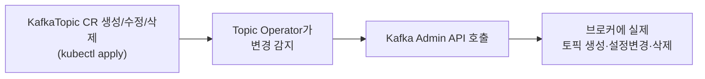

# Strimzi Topic Operator와 KafkaTopic CR

> 최종 업데이트: 2026-09-08 | Strimzi 기준

## 개념

**Strimzi**는 Kafka를 Kubernetes 위에서 선언형으로 운영할 수 있게 해주는 오픈소스 Operator다. 이 중 **Topic Operator**는 K8s의 `KafkaTopic` CR(Custom Resource)을 감시하며, **실제 Kafka 브로커의 토픽을 그 선언에 맞게 만들고·바꾸고·지운다.**

> ⚠️ Apache Kafka 프로젝트 자체는 "K8s에서는 이 도구로 배포하라"는 공식 가이드를 제공하지 않는다. Strimzi는 **CNCF Incubating 등급의 벤더 중립 오픈소스**로서 그 공백에서 가장 널리 채택된 선택지일 뿐, "Apache의 공식 권장"은 아니다. Confluent Platform을 쓰면 Confluent 자체 Operator(CFK)가 권장되고, 관리형 서비스(MSK 등)를 쓰면 이 논의 자체가 필요 없다.

핵심은 **"토픽"이라는 이름이 붙은 게 서로 다른 두 시스템에 따로 존재**한다는 점이다.

| | 실체 | 위치 | 저장하는 것 |
|---|------|------|-------------|
| **토픽** | 메시지가 실제로 쌓이는 로그 파일들 | **Kafka 브로커**(디스크) | 실제 메시지 데이터 |
| **`KafkaTopic` CR** | "이런 토픽을 만들어라"는 선언 | **K8s etcd** | 파티션 수·복제 계수 등 **설정값**만 |

`KafkaTopic` CR을 만든다고 메시지를 저장할 공간이 저절로 생기지 않는다 — CR은 그냥 K8s에 저장된 "요청서" 한 장이고, 실제로 파티션·세그먼트 파일을 만드는 건 Kafka 브로커가 하는 일이다.

## 배경/역사

**Strimzi**는 2016년 3월 첫 커밋으로 시작된 오픈소스 프로젝트로, Red Hat 소속 엔지니어들이 핵심 컨트리뷰터로 참여해왔다. 2019년 8월 **CNCF Sandbox**로 승인됐고, 2024년 2월 **CNCF Incubating** 등급으로 올라섰다. Kafka를 K8s에서 운영할 때 겪는 복잡함(브로커 배포, 인증서, 인증, 토픽/사용자 관리 등)을 CRD 기반으로 선언형으로 다룰 수 있게 해주는 것이 핵심 가치다.

**실제 도입 사례** — Strimzi 공식 사이트가 자체 집계한 사용 사례 목록에는 **Reddit, CERN, AppsFlyer, Swisscom, Hetzner, Decathlon Digital, REWE Digital** 등이 이름을 올리고 있다. 단 이 목록은 회사가 스스로 공개에 동의한 자발적 사례 모음이라, "업계 전체의 대세"를 증명하는 통계는 아니다 — 자체 운영을 택한 조직 중에서는 널리 쓰이지만, 대규모 서비스 기업 다수는 관리형 Kafka(MSK 등)나 자체 내부 툴링으로 이 논의 자체를 우회하기도 한다.

## 구조 — CRD + CR + Operator

이 관계는 이미 [CRD와 Operator 패턴](../DevOps/kubernetes/CRD와-Operator-패턴.md)에서 다룬 구도와 정확히 같다.

| 구성 | 역할 |
|------|------|
| **CRD** | `KafkaTopic`이라는 새 리소스 타입을 K8s에 등록 (Strimzi가 설치 시 등록) |
| **CR** | 실제로 만들 토픽 하나하나에 대한 YAML 인스턴스 |
| **Topic Operator** | CR을 감시(watch)하며 Kafka Admin API로 실제 토픽을 그에 맞게 조정하는 컨트롤러 |

```yaml
apiVersion: kafka.strimzi.io/v1beta2
kind: KafkaTopic
metadata:
  name: orders
  labels:
    strimzi.io/cluster: my-cluster   # 어느 Kafka 클러스터의 토픽인지
spec:
  partitions: 6
  replicas: 3
  config:
    retention.ms: 604800000
```

## 동작 — Reconciliation Loop



CR이 생성·수정·삭제될 때마다 Topic Operator가 그 변화를 읽고, **Kafka Admin API**를 호출해 브로커의 실제 토픽을 같은 상태로 맞춘다. [선언형 vs 명령형](../CS-이론/선언형-vs-명령형.md)에서 다룬 reconciliation loop와 동일한 원리 — "원하는 상태(CR)"와 "실제 상태(브로커의 토픽)"를 계속 비교해 다르면 맞춘다.

## "1:1로 짝이 맞습니다" — 그리고 깨지는 경우

정상적으로는 `KafkaTopic` CR 하나가 실제 토픽 하나와 정확히 짝을 이루도록 Operator가 계속 맞춰준다. 하지만 이 짝은 **K8s를 거치지 않고 토픽을 직접 조작**하면 깨질 수 있다.

| 상황 | 결과 |
|------|------|
| `kafka-topics.sh`로 토픽을 **직접 삭제** | CR은 남아있는데 실제 토픽이 없음 |
| `kafka-topics.sh`로 토픽을 **직접 생성** | 실제 토픽은 있는데 매칭되는 CR이 없음 |
| CR의 `partitions` 값을 **줄이는** 방향으로 수정 | Kafka 자체가 파티션 축소를 지원하지 않아 Operator가 이 변경을 거부·에러 처리 |

그래서 Strimzi로 관리하는 클러스터에서는 **토픽 조작을 CLI로 직접 하지 말고 항상 `KafkaTopic` CR을 통해서만 하는 것이 원칙**이다 — CR을 유일한 진실의 소스(source of truth)로 유지해야 Operator가 실제 상태를 정확히 추적·복구할 수 있다.

## 정리

> **토픽(브로커의 실제 데이터)과 `KafkaTopic` CR(K8s의 선언서)은 서로 다른 시스템에 있는 별개의 객체다.** CR을 만든다고 토픽이 저절로 생기는 게 아니라, Strimzi의 **Topic Operator**가 CR을 감시하며 Kafka Admin API로 실제 토픽을 만들어야 반영된다. 보통은 CR 하나에 토픽 하나가 짝을 이루지만, 누군가 K8s를 거치지 않고 CLI로 토픽을 직접 조작하면 이 짝이 깨질 수 있어 — 그래서 토픽 변경은 항상 CR을 통해서만 해야 한다.

## 관련 문서

- [CRD와 Operator 패턴](../DevOps/kubernetes/CRD와-Operator-패턴.md) — `KafkaTopic` CR이 따르는 CRD+CR+Controller 구조
- [Kafka-Topic.md](Kafka-Topic.md) — 토픽·파티션의 실체와 비용 구조
- [선언형 vs 명령형](../CS-이론/선언형-vs-명령형.md) — Topic Operator의 reconciliation loop 원리
- [Kafka-파티션-컨슈머-스케일링.md](Kafka-파티션-컨슈머-스케일링.md) — 파티션 수를 정하는 전략(CR의 `partitions` 값과 직결)

## 출처

- [Strimzi 공식 사이트](https://strimzi.io/)
- [CNCF — Strimzi Project Page](https://www.cncf.io/projects/strimzi/)
- [Strimzi Documentation — Topic Operator](https://strimzi.io/docs/operators/latest/overview)
